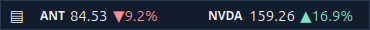

# OKX 桌面实时行情

一个基于 Python 和 PyQt5 的透明桌面行情工具，默认显示 NVDAUSDT 永续合约，支持切换 OKX 当前可用的 USDT 永续合约。


截图中的价格为拍摄时的行情快照。

## 功能

- 红绿蜡烛 K 线和上下影线，显示近两小时的 1 分钟行情。
- 鼠标悬停显示十字线、时间、开盘价、最高价、最低价、收盘价、成交量和涨跌幅。
- 左上角切换品种，提供半导体、AI 科技、加密货币、自选和全部分类。
- 支持代码和中文名称搜索，添加到自选并切换。
- 按合约最小价格变动单位显示报价精度。
- 支持拖动、背景透明度调整和置顶。
- 支持缩成顶部行情条，同时查看 ANT 和 NVDA 的价格及 24 小时涨跌幅。
- 精简行情条可以按住拖动，会记住自己的位置。
- 显示断线、行情延迟及自动重试状态。
- 记录窗口位置、透明度、自选列表和上次选中的品种。




## 运行环境

已在 Ubuntu 24.04 的 GNOME 桌面验证。程序使用系统 Python，图形后端固定为 XCB。Wayland 会话通过 XWayland 显示窗口。

在 Ubuntu 安装依赖：

```bash
sudo apt update
sudo apt install python3-pyqt5 python3-gi gir1.2-glib-2.0 libx11-6 xwayland xdg-user-dirs
```

## 启动

在图形桌面的终端执行：

```bash
git clone https://github.com/tulay-hub/okx-desktop-ticker.git
cd okx-desktop-ticker
./launch.sh
```

创建桌面快捷方式：

```bash
/usr/bin/python3 install_desktop.py
```

安装后双击桌面的“OKX 实时行情”。安装脚本会写入当前克隆目录的启动路径。

## 操作

1. 点击左上角品种名称后的下拉箭头，选择分类或搜索品种。
2. 选中结果，点击“添加到自选并切换”。
3. 鼠标放在 K 线上，查看对应分钟的行情。
4. 拖动窗口调整位置，右键或右上角菜单调整透明度与置顶。
5. 点击右上角的 **−** 缩成精简行情条。首次显示在系统顶栏下方，按住行情条任意位置可以拖动。点击 ANT 或 NVDA 展开对应的 K 线，点击行情条左侧的图表按钮展开当前品种。
6. 点击行情窗右上角关闭按钮退出。

品种列表取自 OKX 当前可用的 USDT 永续合约。预设中的品种也以实时列表为准。ANT 是 Anthropic（Claude）的股票永续合约，在 OKX API 中使用 `ANTHROPIC-USDT-SWAP`。可以在「AI 科技」中选择，也可以搜索 ANT、Anthropic、Claude 或克劳德。

## 行情与刷新

使用 OKX 公共 REST API：

- `/api/v5/public/instruments?instType=SWAP` 获取合约和报价精度。
- `/api/v5/market/ticker` 获取最新价格与 24 小时行情。
- `/api/v5/market/candles` 获取 1 分钟 K 线。

价格约每 2 秒轮询，历史 K 线约每 30 秒同步。当前未收盘 K 线随最新报价更新。新分钟的官方 K 线尚未同步时，悬停卡片会标记“实时估算，待 K 线同步”。

程序优先使用环境代理。环境中未设置 HTTPS 代理时，会读取 GNOME 的手动系统代理。桌面启动和终端启动均支持该行为。

## 本地设置与日志

程序在运行目录生成以下文件：

| 文件 | 用途 |
| --- | --- |
| `settings.ini` | 完整窗口与精简行情条的位置、透明度、自选列表和选中品种 |
| `runtime.log` | 启动、关闭、首批报价和连接错误 |
| `runtime.lock` | 同一目录的单实例锁 |

这些运行文件已列入 `.gitignore`。

## 验证

语法检查：

```bash
/usr/bin/python3 -m py_compile widget.py install_desktop.py
```

在图形桌面执行启动验证。执行前关闭同一目录的行情窗口，以释放单实例锁：

```bash
./launch.sh --smoke-test /tmp/okx-widget-verification.json --snapshot /tmp/okx-widget-preview.png
```

验证要求取得至少三个不同、持续推进且足够新鲜的行情时间戳，并加载 K 线。完成后保存报告和截图并退出。

已执行的桌面交互检查覆盖 K 线悬停、NVDA 切换至 AMD、连续报价、搜索、自选保存、旧品种数据过滤和报价精度。
