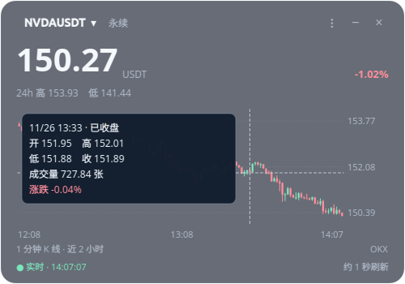
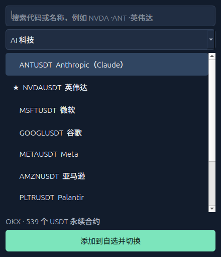

# OKX 桌面实时行情

在 Linux 桌面用置顶窗口查看 OKX USDT 永续行情。完整窗口默认打开 NVDA 的 1 分钟 K 线，缩小后可同时查看 ANT（Anthropic / Claude）和 NVDA。报价约每 1 秒请求一次，使用 OKX 公开行情接口，无需 API 密钥。

## 功能与使用截图

截图使用新版程序拍摄，价格为拍摄时的行情快照。

### 完整窗口与 K 线

显示近两小时的 1 分钟蜡烛 K 线、最新价和 24 小时行情。把鼠标移到 K 线上，可查看十字线及对应时间、开高低收、成交量和涨跌幅。价格精度随所选合约切换。拖动窗口可调整位置，右键或点击右上角的 **⋮** 可调整背景透明度和置顶。



### 精简行情条

点击完整窗口右上角的 **−**，切换到同时显示 **ANT** 与 **NVDA** 价格及 24 小时涨跌幅的精简条。按住行情条拖动即可移动，右键可以选择完全透明、70% 透明、半透明或接近不透明。点击 **ANT** 或 **NVDA** 展开对应 K 线，点击左侧图表按钮恢复之前查看的品种。精简条单独记住位置和透明度。


上方为 70% 透明，下方为完全透明。两种效果使用同一演示底色。

### 品种搜索与自选

点击完整窗口左上角的品种名称，可浏览半导体、AI 科技、加密货币、自选和全部分类。也可以按代码或中文名称搜索。选中结果后点击 **添加到自选并切换**。自选列表和当前品种会保存在本机。

**ANT 指 Anthropic（Claude）股票永续。** 可以在「AI 科技」分类中找到它，或搜索 `ANT`、`Anthropic`、`Claude`、`克劳德`。对应的 OKX API 合约代码为 `ANTHROPIC-USDT-SWAP`。



## 运行环境

已在 Ubuntu 24.04 的 GNOME 桌面验证。程序使用系统 Python，图形后端固定为 XCB。Wayland 会话通过 XWayland 显示窗口。

在 Ubuntu 安装依赖：

```bash
sudo apt update
sudo apt install python3-pyqt5 python3-gi gir1.2-glib-2.0 libx11-6 xwayland xdg-user-dirs
```

## 安装与启动

在图形桌面的终端执行以下命令。

```bash
git clone https://github.com/tulay-hub/okx-desktop-ticker.git
cd okx-desktop-ticker
./launch.sh
```

需要直接打开精简行情条时，可以在仓库目录执行 `./launch.sh --compact`。需要桌面快捷方式时，运行安装脚本。

```bash
/usr/bin/python3 install_desktop.py
```

安装后双击桌面的“OKX 实时行情”。安装脚本会写入当前克隆目录的启动路径。

## 行情与刷新

品种列表取自 OKX 当前可用的 USDT 永续合约，板块预设以该列表为准。程序使用以下公开接口。

- `/api/v5/public/instruments?instType=SWAP` 获取合约和报价精度。
- `/api/v5/market/ticker` 获取最新价格与 24 小时行情。
- `/api/v5/market/candles` 获取 1 分钟 K 线。

完整窗和精简条均约每 1 秒请求一次报价。完整窗口的历史 K 线约每 10 秒同步，未收盘 K 线随最新报价更新。新分钟的官方 K 线尚未同步时，悬停卡片会标记“实时估算，待 K 线同步”。遇到连接中断或行情延迟时，窗口会显示状态并继续尝试刷新。

程序优先使用环境代理。环境中未设置 HTTPS 代理时，会读取 GNOME 的手动系统代理。桌面启动和终端启动均支持该行为。

## 本地设置与日志

程序在运行目录生成以下文件：

| 文件 | 用途 |
| --- | --- |
| `settings.ini` | 完整窗口与精简行情条的位置、透明度、自选列表和选中品种 |
| `runtime.log` | 启动、关闭、首批报价和连接错误 |
| `runtime.lock` | 同一目录的单实例锁 |

这些运行文件已列入 `.gitignore`。

## 验证

语法检查：

```bash
/usr/bin/python3 -m py_compile widget.py install_desktop.py
```

在图形桌面执行启动验证。执行前关闭同一目录的行情窗口，以释放单实例锁：

```bash
./launch.sh --smoke-test /tmp/okx-widget-verification.json --snapshot /tmp/okx-widget-preview.png
```

验证要求取得至少三个不同、持续推进且足够新鲜的行情时间戳，并加载 K 线。完成后保存报告和截图并退出。

已在桌面检查 K 线悬停、品种切换、搜索和自选保存，以及精简条的双路报价刷新、拖动、位置恢复、透明度切换与保存、透明状态下的点击展开。
